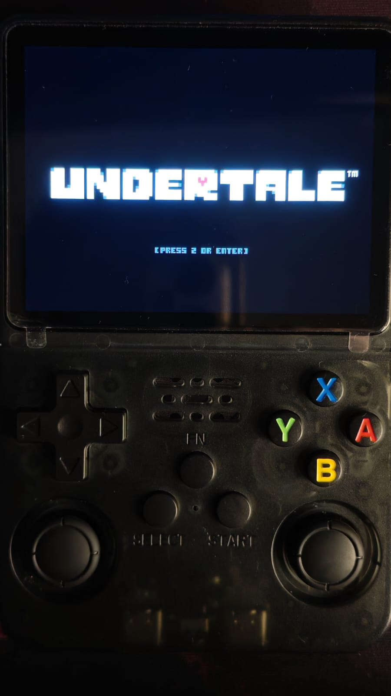
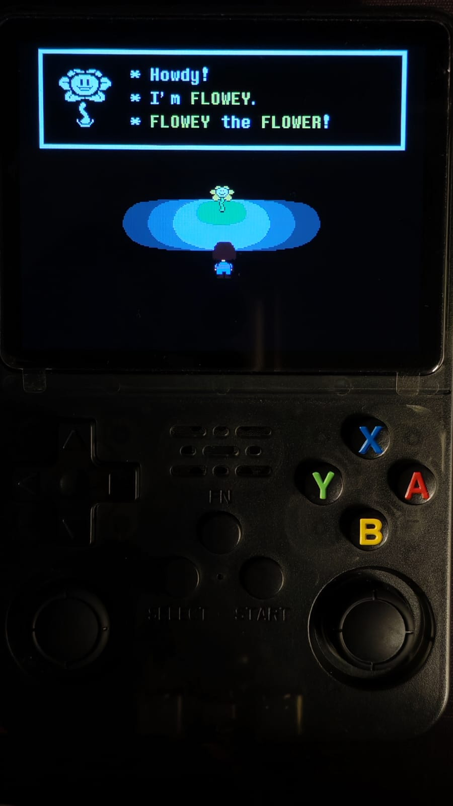
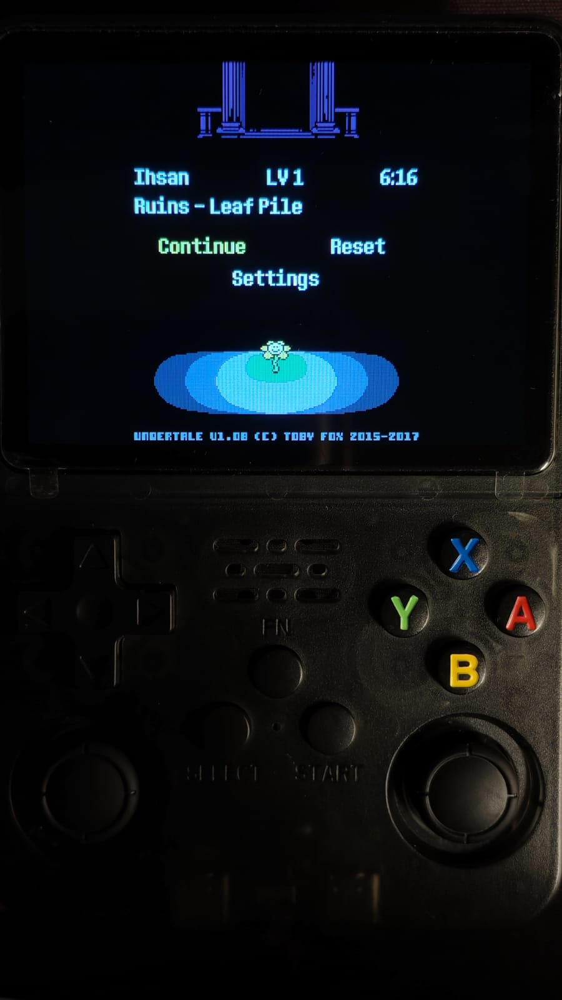
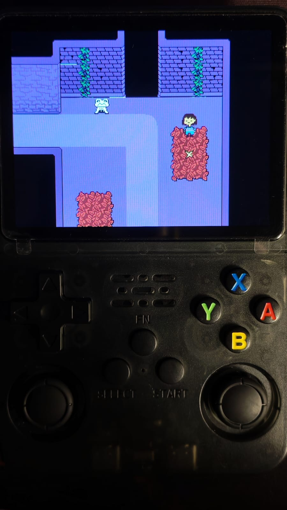
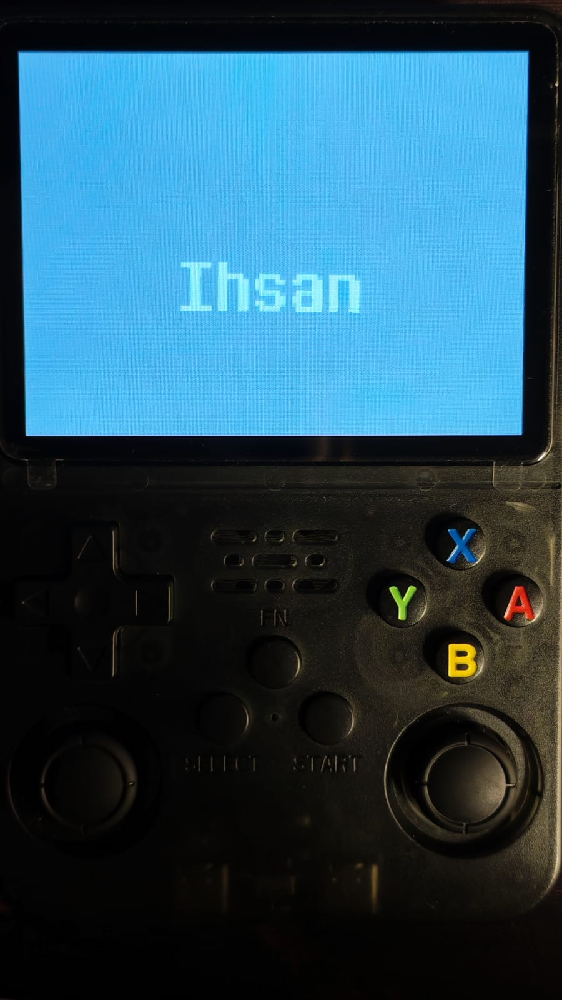
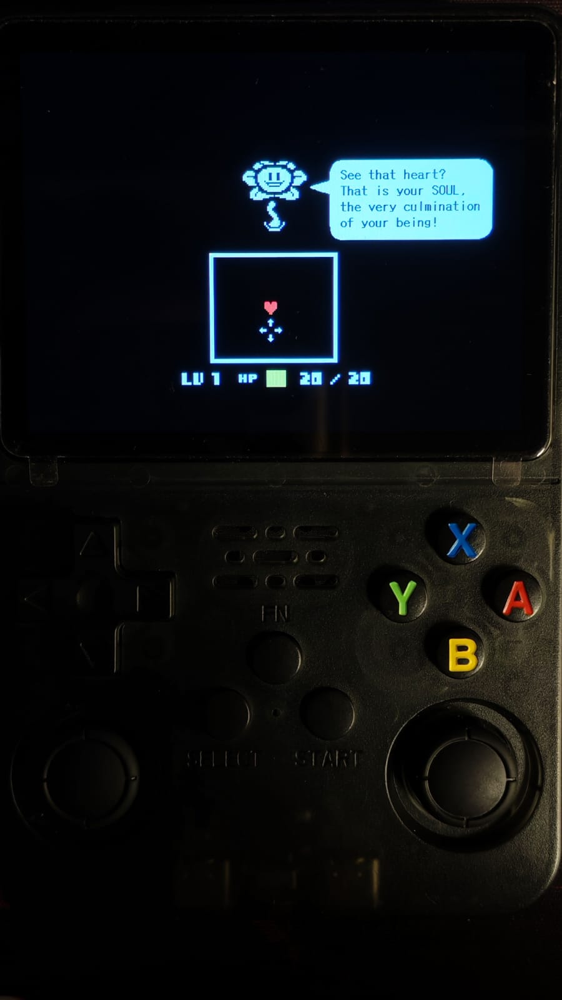

# Undertale on GA36 - goodluckOS

A community Undertale port setup for GA36 / R36S clone handhelds.

## Device

- **Device:** GA36-MB v1.2 (R36S clone)
- **SoC:** Allwinner A23
- **GPU:** Mali-400
- **RAM:** 512 MB
- **OS:** goodluckOS 0.1.0

## Requirements

- GA36-MB v1.2 (Allwinner A23, Mali-400, 512 MB RAM)
- goodluckOS 0.1.0
- A compatible ARMHF Linux build of [Butterscotch](https://github.com/cobaltgit/Butterscotch/tree/miyoomini-v2)
- Your own legally obtained Undertale v1.08 Windows game files

## Installation

### Setup

1. Build or obtain a compatible ARMHF Linux Butterscotch executable.
2. Place it at `ports/undertale/butterscotch`.
3. Copy your own `data.win` and required game assets, including the `.ogg` audio files, into `ports/undertale/`.
4. Extract this repository's files into the root of the goodluckOS HOME partition on your SD card, merging existing folders.
5. Ensure your game files are in `HOME/ports/undertale/`.
6. Safely eject the SD card, insert it into the handheld, and launch **Undertale** from the Games category in Puppy.

### Saves and Logs

- Save files are stored in `ports/undertale/saves/`; the launcher creates this directory automatically.
- The launcher writes its debug log to `/home/player/undertale-launcher-debug.log`.

## Screenshots

Undertale running on the GA36-MB (R36S clone) with goodluckOS 0.1.0.

| Intro | Main Menu |
| ----- | --------- |
|  |  |

| Gameplay | Name Entry |
| -------- | ---------- |
|  |  |

| Dialogue | Flowey Battle |
| -------- | ------------- |
|  |  |

## Debug overlay
The launcher omits the `--debug` argument to prevent the FPS/RAM debug overlay from appearing.

## Credits
- Butterscotch: [Cobalt's Miyoo Mini v2 fork](https://github.com/cobaltgit/Butterscotch/tree/miyoomini-v2)
- Undertale: Toby Fox

This project does not distribute Undertale game assets.

[ Türkçe kurulum rehberi (INSTALL-TR.txt) ](INSTALL-TR.txt)
